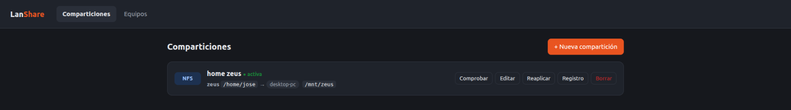
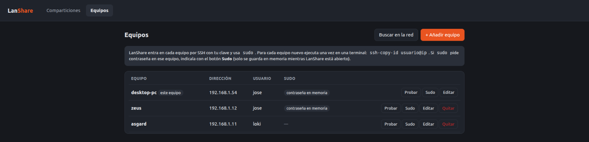
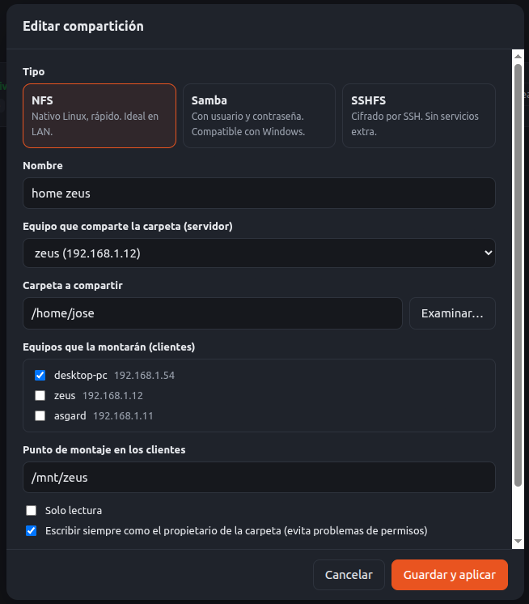

# LanShare

Gestor web para crear y administrar carpetas compartidas entre equipos Ubuntu de la red local.

Corre en un único equipo y controla el resto por SSH: exporta la carpeta en el equipo servidor y la monta en los clientes, todo desde una interfaz web sencilla.



## Capturas

**Equipos gestionados:** el propio equipo y los remotos añadidos tras buscarlos en la red.



**Crear o editar una compartición:** el tipo, el servidor y la carpeta, los clientes y el punto de montaje.



## Funcionalidades

- **Descubrimiento de equipos** en la LAN (mDNS, barrido del puerto 22 y tabla ARP). Solo se listan los equipos con SSH, que son los gestionables, y de cada uno se muestra:
  - sistema operativo: exacto si tu clave ya entra, o estimado por el banner SSH si no;
  - MAC y fabricante, por ejemplo Raspberry Pi;
  - IP adicionales del mismo equipo;
  - si tu clave tiene acceso y si `sudo` pide contraseña;
  - si ya comparte por Samba o NFS.
- **Tres tipos de compartición:**
  - **NFS**: nativo de Linux y rápido. Opción para escribir siempre como el propietario de la carpeta y evitar problemas de UID.
  - **Samba**: con usuario y contraseña, compatible con Windows.
  - **SSHFS**: cifrado por SSH, sin servicios extra en el servidor.
- **Gestión completa:** crear, editar, reaplicar, comprobar el montaje, ver el registro y borrar.
- **Montajes persistentes** en `/etc/fstab` con `x-systemd.automount` y `nofail`: sobreviven a reinicios y no bloquean el arranque si el servidor está apagado.
- **Comprobación previa** de SSH y `sudo` en todos los equipos antes de cambiar nada.
- Instala automáticamente los paquetes que falten (`nfs-kernel-server`, `nfs-common`, `samba`, `cifs-utils`, `sshfs`).

## Requisitos

- Ubuntu (probado en 22.04) con Python 3.10 o superior. Solo usa la librería estándar.
- Una clave SSH en el equipo donde corre LanShare (`ssh-keygen -t ed25519`).
- En cada equipo gestionado:
  - `openssh-server` instalado.
  - Tu clave autorizada: `ssh-copy-id usuario@ip`.
  - Un usuario con permiso de `sudo`. Si pide contraseña, se indica desde la web y se guarda **solo en memoria** (ver [Contraseñas de sudo](#contraseñas-de-sudo)).

## Instalación

```bash
git clone https://github.com/jruzafa/easy-lan-share.git
cd easy-lan-share
./install.sh
```

Abre <http://127.0.0.1:8765>.

El instalador:
- comprueba los requisitos y ofrece instalar lo que falte (`openssh-client`, `avahi-utils`) y crear una clave SSH;
- copia la app a `~/.local/share/easy-lan-share`, así que puedes borrar el clon después;
- crea y arranca el servicio `systemd --user` `lanshare`, que se inicia al iniciar sesión.

| Comando | Qué hace |
|---|---|
| `./install.sh` | Instala o actualiza |
| `./install.sh --port 9000` | Usa otro puerto |
| `./install.sh --uninstall` | Quita la app y el servicio, y conserva la configuración |
| `./install.sh --purge` | Igual que `--uninstall` y además borra `~/.config/lanshare` |

> Instalar, actualizar o reiniciar el servicio reinicia el proceso y **borra las contraseñas de sudo guardadas en memoria**: habrá que volver a indicarlas con el botón **Sudo**.

Desinstalar no quita las comparticiones de los equipos. Bórralas antes desde la web si ya no las quieres.

Para desarrollo, ejecútalo directamente desde el repo en otro puerto: `python3 lanshare.py --port 8766`.

### Actualizar

```bash
cd easy-lan-share
git pull
./install.sh
```

Tus equipos y comparticiones se conservan, pero hay que volver a indicar las contraseñas de sudo.

### Arrancar sin iniciar sesión

El servicio es de usuario, así que arranca cuando inicias sesión. Si LanShare corre en un equipo sin escritorio o al que entras solo por SSH, activa el *linger* para que arranque con el sistema:

```bash
loginctl enable-linger $USER
```

## Uso

1. **Equipos → Buscar en la red** y añade los equipos que tengan SSH.
2. **Probar** comprueba la conexión SSH y `sudo`. Si `sudo` pide contraseña, indícala con **Sudo** (se guarda solo en memoria).
3. **Comparticiones → Nueva compartición:** elige el tipo, el servidor, la carpeta, los clientes y el punto de montaje. Si a algún equipo le falta la contraseña de sudo, el diálogo lo avisa antes de crear, con un botón para indicarla ahí mismo.

## Contraseñas de sudo

LanShare necesita `sudo` en cada equipo para crear, editar, reaplicar o borrar comparticiones. Si `sudo` pide contraseña en un equipo, se indica con el botón **Sudo** de la pestaña **Equipos**, y:

- **Se guarda solo en la memoria** del proceso de LanShare. Nunca se escribe en disco, ni en `state.json` ni en ningún otro sitio.
- **Se pierde** al reiniciar el PC, al cerrar sesión, al reiniciar o parar el servicio y al instalar o actualizar con `install.sh`.
- La columna **Sudo** de la pestaña Equipos indica si hay una contraseña cargada («contraseña en memoria»).
- Al crear o editar una compartición, el diálogo comprueba `sudo` en el servidor y los clientes elegidos. Si a alguno le falta la contraseña, o la guardada es incorrecta, lo avisa y no deja crear hasta indicarla.
- Si aun así falta, LanShare **no cambia nada**: la comprobación previa lo detecta y dice en qué equipos hay que indicarla.

Las comparticiones ya creadas **no** necesitan la contraseña para funcionar. Solo hace falta para gestionarlas.

Si prefieres no volver a introducirla, puedes configurar `sudo` sin contraseña para tu usuario en esos equipos. Es más cómodo, pero menos seguro: cualquier programa que se ejecute con tu usuario podría hacerse root sin pedir nada.

Al borrar una compartición se desmonta en los clientes y se deja de compartir. **Los archivos no se borran.**

## Dónde se guarda la configuración

| Qué | Dónde |
|---|---|
| Equipos y comparticiones | `~/.config/lanshare/state.json` (permisos 600) |
| Exportación NFS | `/etc/exports.d/lanshare-<id>.exports` en el servidor |
| Recurso Samba | `/etc/samba/lanshare.conf` en el servidor (incluido desde `smb.conf`) |
| Montaje | `/etc/fstab` en el cliente, entre `# BEGIN lanshare:<id>` y `# END lanshare:<id>` |
| Credenciales y claves de cliente | `/etc/lanshare/` en el cliente |
| Contraseñas de sudo | **Solo en memoria** del proceso de LanShare; nunca en disco |
| App instalada | `~/.local/share/easy-lan-share/` |
| Servicio | `~/.config/systemd/user/lanshare.service` |

Las comparticiones funcionan aunque LanShare esté parado; la app solo hace falta para gestionarlas.

## Seguridad

- La web escucha **solo en `127.0.0.1`**. Quien accede a ella puede ejecutar comandos como root en todos los equipos gestionados.
- Para evitar peticiones desde otras webs (CSRF) y ataques de DNS rebinding, la API exige la cabecera `X-LanShare: 1` y que el `Host` sea localhost.
- Las contraseñas de `sudo` se guardan **solo en memoria** y nunca se escriben en disco. Se pierden al reiniciar el servicio.
- Las contraseñas Samba se guardan en `state.json` porque hacen falta para poder editar la compartición.
- **Buscar en la red** intenta entrar por SSH con tu clave en cada equipo encontrado, para leer el sistema y saber si `sudo` pide contraseña. No guarda su huella en `known_hosts`. Si algún equipo usa `fail2ban` muy estricto, esos intentos pueden contar como fallidos.
- Si un equipo tiene `ufw` activo, abre los puertos a mano: NFS 2049, Samba 445.

## Solución de problemas

| Síntoma | Solución |
|---|---|
| «necesita la contraseña de sudo» | Indícala con el botón **Sudo** en la pestaña Equipos. |
| «La clave SSH no está autorizada» | `ssh-copy-id usuario@ip` desde el equipo donde corre LanShare. |
| `REMOTE HOST IDENTIFICATION HAS CHANGED` (el equipo se ha reinstalado) | `ssh-keygen -R ip` y vuelve a **Probar**. En SSHFS, quita también la huella antigua en cada cliente: `sudo ssh-keygen -R ip -f /etc/lanshare/known_hosts`, y **Reaplica**. |
| Un servidor ha cambiado de IP | Edita el equipo con la IP nueva y **Reaplica** cada compartición que lo use. Mejor fija la IP o reserva una en el router (DHCP). |
| El montaje no responde y el servidor está encendido | Revisa el cortafuegos (`sudo ufw allow from 192.168.1.0/24 to any port 2049` para NFS, o `port 445` para Samba). |
| NFS: no puedo escribir | Activa «Escribir siempre como el propietario de la carpeta» o revisa los permisos de la carpeta en el servidor. |
| Ver qué ha pasado | Botón **Registro** de la compartición, o `journalctl --user -u lanshare -f` para el servicio. |

## Estructura

```
lanshare.py   servidor HTTP, API y generación de los scripts que se ejecutan en los equipos
index.html    interfaz web (HTML, CSS y JS sin dependencias)
install.sh    instalador / desinstalador (genera la unidad de systemd --user)
docs/         capturas del README
CLAUDE.md     notas para agentes de IA (AGENTS.md es un enlace a este fichero)
```
